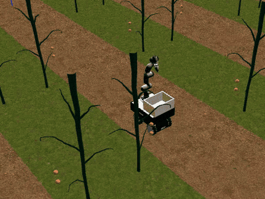
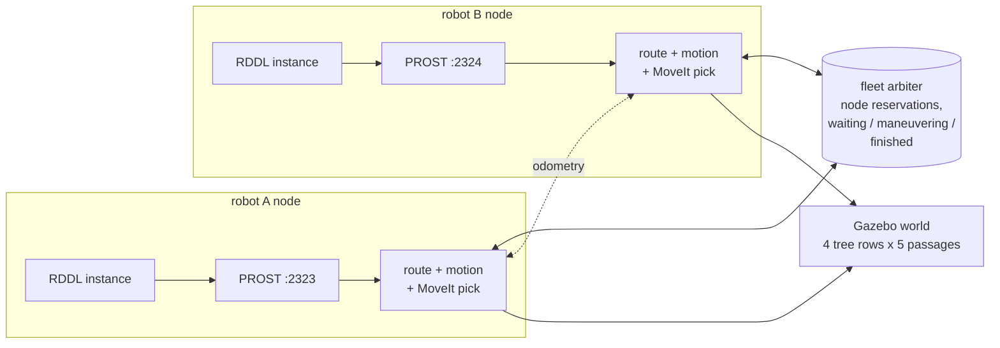
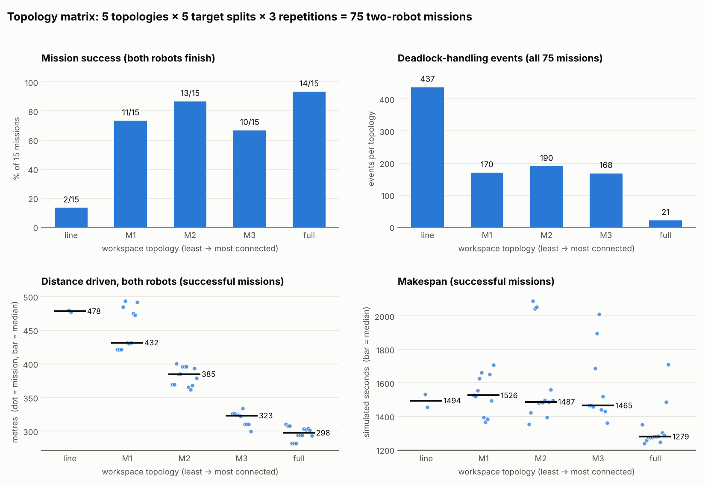
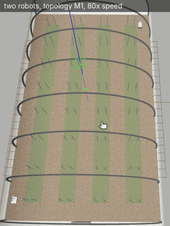

# HARBOT Orchard Picker

Two mobile manipulators harvesting fruit in a simulated orchard. Each robot
plans with PROST (RDDL), drives and picks in Gazebo with MoveIt, and the two
robots coordinate so they do not collide or block each other in the narrow
passages.

[](https://github.com/lukakandic02-svg/harbot-orchard-picker/actions/workflows/ci.yml)


[](LICENSE)

<p align="center">
  <br>
  <sub>Picking fruit from a tree and dropping it into the basket (Gazebo, 4x speed).</sub>
</p>

This is the code for my master's thesis at the School of Electrical
Engineering, University of Belgrade (Signals and Systems, 2026): *Planning
and coordination of multiple robots in an agricultural environment: an
analysis of the effect of workspace topology*.

## Overview

Each robot (Robotnik RB-KAIROS mecanum base with a 7-DoF arm) runs a closed
loop: it writes its current state as an RDDL instance, asks PROST which tree
to harvest next, drives there on the orchard graph and picks both fruits on
that tree with MoveIt. Two robots do this at the same time in one shared
orchard. The passages are narrow and a robot can change passage only at a
row end or through a gap between two trees.

Main parts:

* Symbolic planning connected to the simulator. A new RDDL instance is
  generated every cycle; PROST chooses the order of targets and the robot
  drives the route on the same graph. Things the planner does not model
  (basket and depot trips, two fruits per tree, grasp retries, tilt) are
  handled in the execution layer.
* Coordination between the robots: shared odometry, a proximity hold with a
  fixed priority, and node reservation (all nodes of a segment are locked at
  once, in sorted order, so reservations cannot deadlock).
* Deadlock detection and resolution in steps: keep-right pass in a shared
  passage, a bypass arc behind the row end, rerouting, and retreat. No
  maneuver is allowed closer than 0.65 m to the other robot.
* An experiment with 75 two-robot missions on five workspace topologies,
  run unattended on frozen code and analysed from the logs.



Details are in [docs/architecture.md](docs/architecture.md).

## Results



The workspace graph was varied from a single serpentine path (`line`) to a
layout with both row ends and 28 mid-row shortcuts (`full`), see
[docs/topologies.md](docs/topologies.md):


* Mission success went from 13 % (line) to 93 % (full), and the distance
  driven dropped by 38 % (Spearman rho = -0.95).
* No safety failures in 75 missions: no tilt aborts, minimum distance
  between the robots 0.647 m. 23 of the 25 failed missions were deadlocks at
  a bottleneck with no alternative route, all in 6 specific seed/topology
  combinations.
* More connected graphs made each PROST cycle slower (20 s -> 46 s), so the
  makespan improved clearly only with the `full` layout.
* Giving the faster robot more of the work made the fleet slower
  (finish-time gap 63 s -> 883 s), because the time per tree is dominated by
  manipulation, not driving.

Details and statistics: [docs/experiments.md](docs/experiments.md).

<p align="center">
  <br>
  <sub>A full two-robot mission, top view (topology M1, 80x speed).
  Full-length recordings: <a href="https://drive.google.com/drive/folders/1FQflIDD-wofjTFoFZoJtSdjmzd6LjOku">simulation videos</a>.</sub>
</p>

## Repository layout

```
src/harbot_orchard_picker/   ROS-free core, unit-tested
  orchard_topology.py          workspace graph and the five topologies
  fleet_arbiter.py             node reservation and shared robot states
  orchard_geometry.py          simulator XY <-> (passage, index)
scripts/                     ROS nodes
  online_orchard_manager.py    planning loop, routing, coordination, deadlock resolution
  orchard_map_picker.py        base motion, lateral pass, bypass arc, tilt monitor
  target_pick_executor.py      fruit picking: base approach, MoveIt, grasp, drop
  report_metrics_recorder.py   trajectory and metrics recording
  generate_*_metrics.py        per-mission metrics after a run
rddl/                        RDDL domains for PROST, example instances
config/                      orchard calibration, target table
experiments/                 run_experiment.sh (one mission), run_topology_matrix.sh (75 missions)
tools/analysis/              matrix summary and figures; results/ has the 75-mission CSV
tests/                       pytest suite (graph, arbiter, geometry)
docs/                        architecture, topologies, experiments
```

## Running

The ROS-free core and its tests need only Python:

```bash
pip install -r requirements-dev.txt
pytest
```

The full simulation needs Ubuntu 20.04, ROS Noetic, Gazebo 11, MoveIt 1 and:

* the HARBOT simulation environment: the greenhouse world and models from
  [AV-Lab/harbot-agri-sim](https://github.com/AV-Lab/harbot-agri-sim), the
  Robotnik RB-KAIROS robot packages and `gazebo_ros_link_attacher`;
* a launch file `rbkairos_sim_bringup/harbot_full_greenhouse.launch` that
  starts the greenhouse world with both robots (written for the thesis
  setup, not included in this repository);
* the [PROST](https://github.com/prost-planner/prost) planner with the
  rddlsim test bed in `~/prost` (or set `PROST_DIR`).

```bash
cd ~/catkin_ws/src
git clone https://github.com/lukakandic02-svg/harbot-orchard-picker.git
cd .. && catkin_make && source devel/setup.bash

src/harbot-orchard-picker/tools/setup_workspace.sh       # calibration, targets, RDDL domain
src/harbot-orchard-picker/experiments/run_experiment.sh dual_topology_full_seed45
```

`run_experiment.sh` without arguments lists all profiles. The whole matrix
is run with `experiments/run_topology_matrix.sh` (about 30 hours of
simulation).

## Limitations

* Research code, tested on one simulated orchard and not on real hardware.
* The simulation is not deterministic: the same code, topology and seed can
  end differently depending on the timing between the two robots, so every
  cell of the matrix was run three times.
* The RDDL domain for the line-based topologies had to be rewritten after
  the experiments ([rddl/README.md](rddl/README.md)), and the orchard
  calibration in `config/` was restored from the logged calibration values.

## Acknowledgements

Thesis mentor: Kosta Jovanović, ETF Belgrade. The simulation environment
(robots, greenhouse, launch files) comes from the HARBOT project's
[harbot-agri-sim](https://github.com/AV-Lab/harbot-agri-sim);
this repository contains the planning, coordination, experiment scripts and
analysis written for the thesis.

## License

[MIT](LICENSE) © 2026 Luka Kandić
