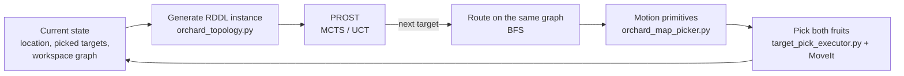
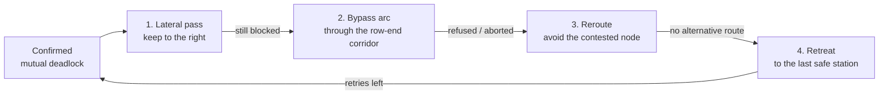

# Architecture

How one robot turns a symbolic plan into motion, and how two robots share
the orchard. Parameter values are the ones used in the topology experiments
(see `experiments/run_experiment.sh`).

## 1. One robot: the online planning loop

Each robot runs its own `online_orchard_manager.py` node, its own PROST
server (ports 2323 / 2324) and its own planner working directory, so the two
robots plan in parallel.

RDDL domain. `rddl/orchard_targets_mdp.rddl` has two object types (`loc`,
`target`), two state fluents (`at`, `picked`), two static relations
(`adjacent`, `target_at`) and two actions (`move_to`, `pick`). The reward is
+1 per picked target, -0.03 per move and -0.01 per step, so PROST minimises
the number of hops to the remaining targets.

Instances. A new instance is generated from the current state in every
decision cycle. The workspace graph is written only as `adjacent(...)`
facts, so changing the topology does not change the domain. Targets that
belong to the other robot are written as already picked, so the robots
never compete for a target.

What PROST decides. The manager takes the plan up to and including the first
`pick`, which gives the next target. The route to it is a BFS on the same
graph PROST used, so the robot never uses an edge that is not in the
instance. In 89 % of the logged cycles the BFS route was the same as PROST's
own move sequence.

Horizon. 20 steps for the `full` topology and 45 for the line-based ones
(their longest path between two stations is 39 hops). Setting the horizon
from the graph diameter instead of the original 65 reduced planning time per
cycle from about 50 s to about 3 s on the single-robot graph.

The execution layer handles what the planner does not model: basket load
and depot trips, the two fruits per tree (upper and lower), pick attempts
(max 3 per target), platform tilt and the other robot.

### Motion and manipulation

Consecutive `move_to` actions in one passage are merged into one continuous
drive. Transfers at the row ends are sideways moves of the mecanum base; a
mid-row shortcut is an alignment step followed by a slower crossing between
two trees. At a target the base moves close enough to reach both fruits,
MoveIt (RRT-Connect, velocity / acceleration scaling 0.30 / 0.15) plans to a
pre-grasp pose above the fruit, and the last part is a straight Cartesian
move. Fruit poses that move more than 0.40 m horizontally or 0.30 m
vertically from the first valid reading are treated as simulator glitches
and rejected.

## 2. Two robots: coordination

Both robots share the whole graph (no zones). Coordination has three layers,
and the distance between the robots is checked on every control tick of
every motion primitive, not once per action.

| Layer | Mechanism | Where |
|---|---|---|
| 1 | Peer awareness: each robot subscribes to the other's odometry | `online_orchard_manager.py` |
| 2 | Proximity hold: inside 1.75 m the non-priority robot stops and waits (robot A has priority) | `wait_for_peer_clearance()`, `wait_for_moving_peer_clearance()` |
| 3 | Node reservation: before a segment, a robot reserves all its nodes at once, in sorted order | `src/harbot_orchard_picker/fleet_arbiter.py` |

Layer 2 alone was not enough, because the priority robot never waits and can
drive into a robot that has stopped. Layer 3 applies to both robots. Since
both robots always take their locks in the same sorted order, two
reservations cannot deadlock each other. Locks are `flock`s on one file per
node and are released automatically when the robot process exits.

The fleet arbiter also stores three broadcast states: waiting for (the nodes
a robot is blocked on), maneuvering (in a bypass arc, the other robot should
hold regardless of priority) and finished (parked for good; a smaller
clearance of 0.75 m is then used, because the depot is a normal graph node
the other robot may need to pass). A robot that ends its mission tilted does
not publish "finished".

### Deadlock detection and resolution

Holds and reservations keep the robots apart, but they can still block each
other, e.g. two robots on neighbouring nodes in one passage, each waiting
for the other's node. A deadlock is confirmed only when the arbiter shows
that the other robot is waiting for a node this robot holds. The
non-priority robot then tries, in order:

1. Lateral pass: when both robots are in the same passage, each one moves to
   its own right side, without any messages. The offsets are 0.20 m on the
   tree side and 1.05 m on the open side; they were measured in the
   simulator by finding the largest offset at which the robot still stays
   level.
2. Bypass arc through the free corridor behind the row end. It is planned as
   a half-ellipse 0.55 m deep (the free depth there is 0.74 m). The planned
   clearance to the other robot must be at least 0.90 m before driving, and
   the arc is aborted if the distance drops below 0.75 m.
3. Reroute around the contested node, if the topology has an alternative
   route and the contested node is not the destination itself.
4. Retreat to the last safe station, computed from the robot's physical
   position (the deadlock can happen in the middle of a segment).

After 9 resolution attempts the robot stops its mission. Every maneuver is
aborted below 0.65 m (the only contact seen during development happened at
0.48 m).

### Safety checks

* Tilt: the base stops above 16 deg roll or pitch and continues once both
  are below 14.5 deg for 0.40 s (within a 20 s window); above 18 deg the
  mission is aborted. The earlier rule (below 8 deg within 2 s) never
  recovered in the logged tilt events, because tilt decays only
  0.14-0.77 deg/s once the robot stops.
* Segment time limits scale with segment length and speed (the lane next to
  the trees is driven at 0.18 m/s).

| Parameter | Value |
|---|---|
| Safety radius to an active robot | 1.75 m |
| Clearance to a finished robot | 0.75 m |
| Absolute abort distance | 0.65 m |
| Wait before deadlock resolution / before proceeding | 30 s / 180 s |
| Lateral offset (tree side / open side) | 0.20 m / 1.05 m |
| Bypass arc depth / min planned clearance / abort distance | 0.55 m / 0.90 m / 0.75 m |
| Max deadlock resolutions per robot | 9 |
| Tilt: stop / recover / abort / window | 16 deg / 14.5 deg / 18 deg / 20 s |
| Passage speed | 0.44 m/s |

## 3. Logs

Besides its full log, each robot writes `field_moves_<robot>.csv` (one row
per location change). The metrics recorder writes the trajectory both in
simulator XY and in map terms (passage, fractional index), using
`orchard_geometry.py`.

The time-aware basket observer (`_time_aware_observer:=true`) only logs the
optimal basket tour for comparison. It is slow for large baskets (about
1100 s per mission with a basket of 24), so it is off by default; it does
not affect routing.
