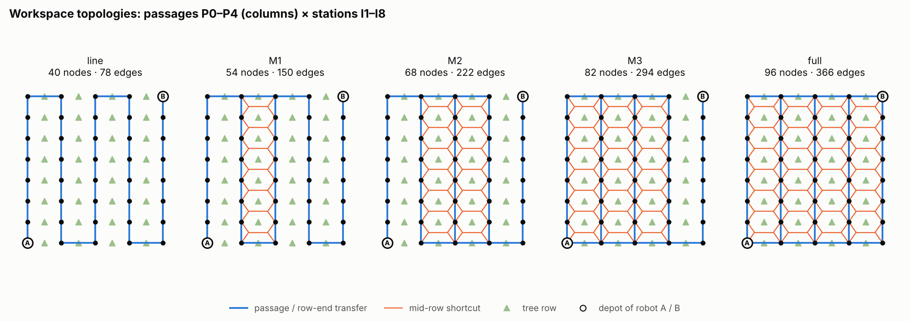

# Workspace graph and topologies

## The graph

The simulated orchard has four tree rows and five passages between and
around them (P0 and P4 are the outer passages). Each passage has eight
stations I1..I8, level with the trees, which gives 40 base nodes named
`P{p}_I{i}`. Stations are 3.61 m apart along a passage and passages are
4.02 m apart. Robot A's depot is `P0_I1`, robot B's is `P4_I8`.

Edges are directed and there are four kinds (`orchard_topology.classify_edge`):

| Kind | Meaning |
|---|---|
| `passage` | drive between neighbouring stations of one passage |
| `transfer` | move sideways to the neighbouring passage at a row end (I1 or I8) |
| `feeder` | station <-> mid-row shortcut node in the same passage |
| `crossing` | mid-row crossing between two neighbouring passages |

Mid-row shortcuts. A shortcut cannot connect `P1_I3` and `P2_I3` directly,
because stations are level with the trees and the straight line would go
through a trunk. Instead, a shortcut adds two helper nodes between two
trees, `P{p}_M{k}_{q}` (passage p, gap k between I{k} and I{k+1}, leading to
neighbour q), and 10 directed edges. The neighbour is part of the name
because an inner passage has two neighbours and can have shortcuts to both
at the same gap. All 28 possible crossings (4 passage pairs x 7 gaps) were
driven in the simulator before the experiments; all were passable, with a
maximum tilt of 0.50 deg.

The graph is built only in `orchard_topology.py`. The RDDL instance for
PROST and the routes the robot drives use the same functions, so the
planner and the motion layer always have the same edges.

## The five topologies

All five have the same 40 stations and the same edges along each passage;
they differ only in how neighbouring passages are connected.

* line: each pair of neighbouring passages is connected at only one row end,
  alternating, so all 40 stations lie on one serpentine path. No station
  has an alternative route around a blocked neighbour.
* M1, M2, M3: one passage pair at a time, starting from the centre, gets
  full connectivity (second row end and all 7 shortcuts): M1 = {P1-P2},
  M2 = {P1-P2, P2-P3}, M3 = {P0-P1, P1-P2, P2-P3}. P3-P4 stays a bottleneck
  until `full`.
* full: every pair connected at both row ends, plus all 28 shortcuts. This
  is not a complete graph, but the most connected layout the robots can
  actually drive.

| Topology | Upgraded pairs | Shortcuts | Nodes | Directed edges | Station diameter (hops) | Bypassable row ends (of 10) |
|---|---|---|---|---|---|---|
| line | - | 0 | 40 | 78 | 39 | 2 |
| M1 | P1-P2 | 7 | 54 | 150 | 25 | 4 |
| M2 | P1-P2, P2-P3 | 14 | 68 | 222 | 25 | 6 |
| M3 | P0-P1, P1-P2, P2-P3 | 21 | 82 | 294 | 18 | 8 |
| full | all | 28 | 96 | 366 | 11 | 10 |

A row end is bypassable if all other stations are still reachable when that
node is blocked, i.e. a robot standing there can be driven around. This was
the best single predictor of mission success: a deadlock at a row end that
is not bypassable can only be resolved by one robot backing off. Both
depots are bypassable in every topology.

All numbers in the table are checked in `tests/test_orchard_topology.py`.

## In the planner

The topology is selected per robot with ROS parameters (`~topology_mode`,
`~topology_redundant_pairs`, `~shortcut_pairs`); see
`orchard_topology.TOPOLOGIES` and `apply_topology_comparison_defaults()` in
`experiments/run_experiment.sh`. The line-based topologies use the RDDL
domain `orchard_targets_line`, see `rddl/README.md`.
